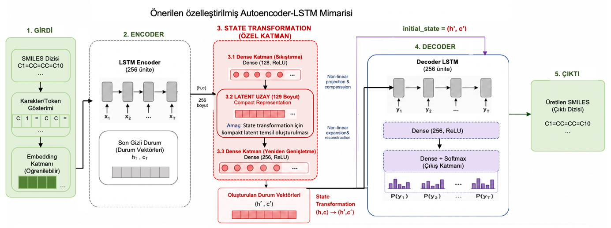
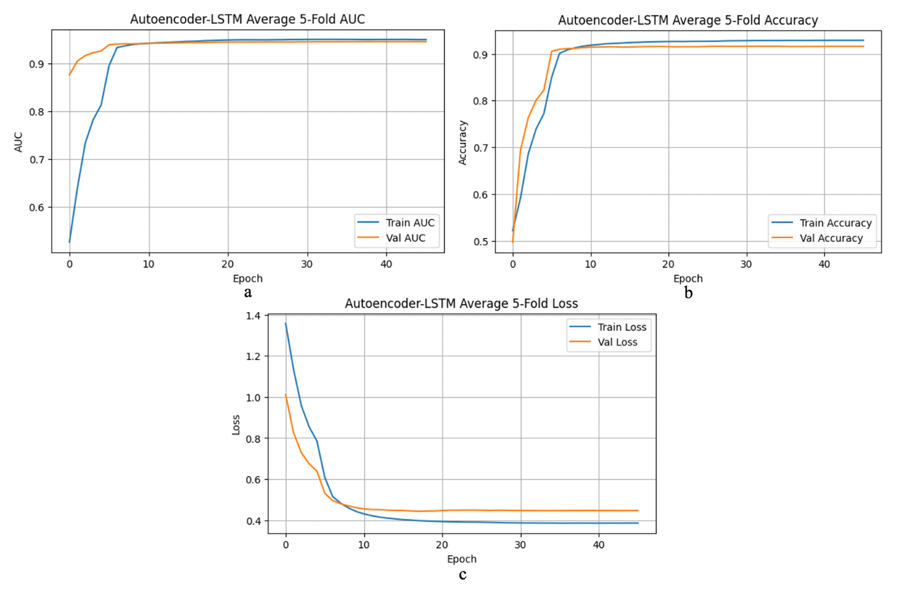
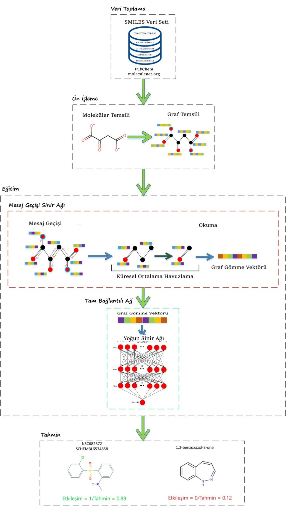
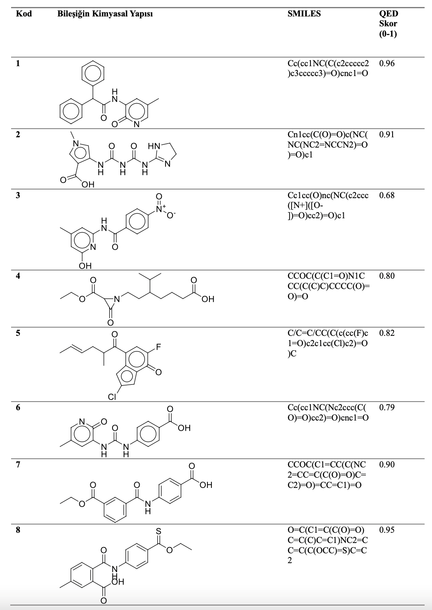
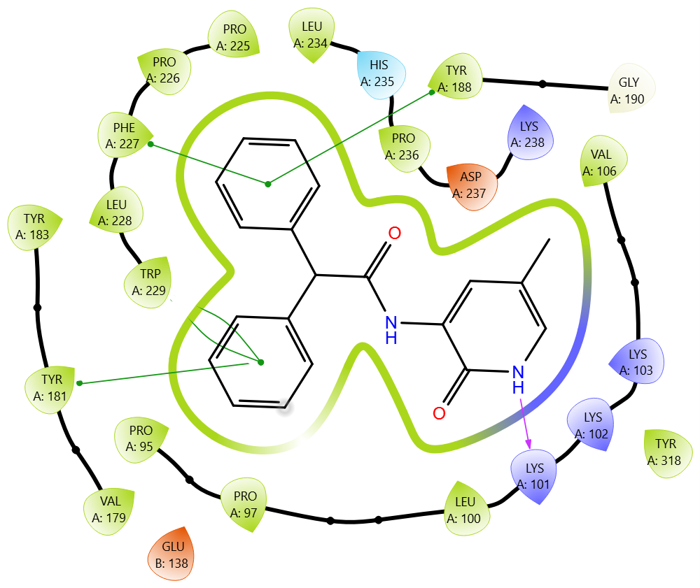
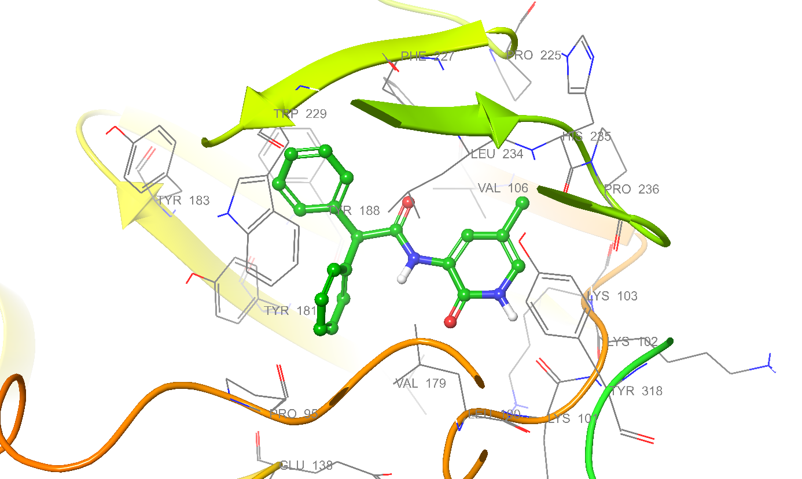
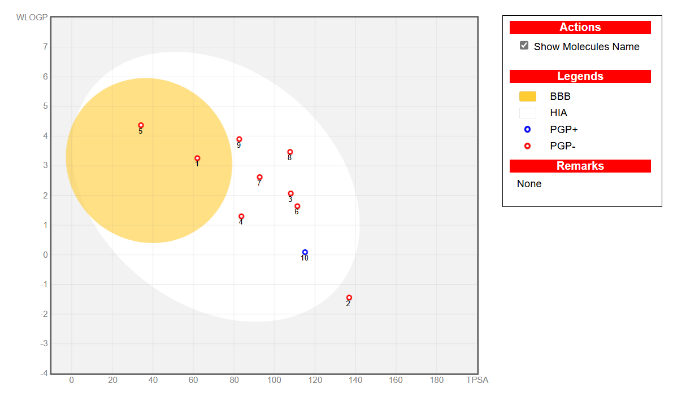

# AI-Driven Anti-HIV Molecule Discovery: Autoencoder-LSTM Generation, Geometric Deep Learning, Docking and ADME

- Uslu, Harun, et al. **"Discovery of new anti-HIV candidate molecules with an AI-based multi-stage system approach using Molecular Docking and ADME predictions."** *Chemometrics and Intelligent Laboratory Systems*, vol. 267, 105543, 2025. [doi:10.1016/j.chemolab.2025.105543](https://doi.org/10.1016/j.chemolab.2025.105543)
- Das, Bihter, et al. **"A Comparative Evaluation Framework Integrating Machine Learning and Deep Learning Models with ADME-Based Pharmacokinetic Assessment for HIV-Related Compounds."** *Pharmaceuticals* (MDPI), 19(8), 1267, 2026. [doi:10.3390/ph19081267](https://doi.org/10.3390/ph19081267)
- Project: *Geometrik Derin Ağ Yaklaşımları Kullanılarak Anti-HIV Etkili Molekül Keşfi Yapan Yeni Bir Model Geliştirilmesi* (Development of a Novel Model for Anti-HIV Molecule Discovery Using Geometric Deep Network Approaches), **TÜBİTAK 1001, Project No. 123E098**
- Principal Investigator: Assoc. Prof. Dr. Bihter Daş, Fırat University

Drug discovery against HIV remains slow and expensive, and current antiretroviral drugs cannot eradicate the virus. This repository provides the code, data and outputs of a **three-stage, fully in silico pipeline** for discovering new anti-HIV candidate molecules:

1. **Molecule generation**: a customized Autoencoder-based LSTM generates novel SMILES sequences that are filtered by drug-likeness rules (Lipinski, Veber, Ghose, Egan).
2. **Interaction prediction**: a Geometric Deep Learning (GDL) model, built on a Message Passing Neural Network (MPNN), scores the candidates on their molecular graphs and prioritizes them with QED drug-likeness.
3. **Biological validation**: prioritized candidates are docked against three HIV-1 targets (protease, integrase, reverse transcriptase) and evaluated with ADME, toxicity, SASA and dipole moment analyses, using the approved NNRTI **rilpivirine** as a reference.

Both stages are benchmarked against classical machine learning and deep learning baselines, re-trained on the same dataset, the same splits and the same protocol.

## Pipeline Overview

| Stage | Work Package | Method | Output |
|---|---|---|---|
| 1. Generation | WP3 | Customized Autoencoder-LSTM (state-transformation) | 50 novel, rule-compliant SMILES candidates |
| 2. Interaction prediction | WP4 | GDL: MPNN + fully connected classifier, QED scoring | HIV activity prediction, prioritized candidates (QED ≥ 0.90) |
| 3. Pre-docking analysis | WP5 | Drug-likeness / ADMET screening, SciFinder novelty check | 10 original lead candidates |
| 4. Docking and ADME | WP6 | AutoDock 4.2 + AutoDock Vina, SwissADME, admetSAR3 | Binding scores, estimated Ki, pharmacokinetic profile |

## Dataset

The data come from **MoleculeNet (HIV)**, selected after reviewing 11 drug databases (PubChem, DrugBank, ChemSpider, ChEMBL, Drugs.com, ChEBI, PharmGKB, LIPID MAPS, FDA Portal, Stanford HIV Drug Resistance Database, MoleculeNet) with pharmacy experts.

- The full pool contains **41,127 compounds** (1,443 active, 39,684 inactive).
- To limit class imbalance, the inactive class was reduced to **1,600** compounds with expert guidance. The working set is therefore **3,043 unique compounds (1,443 active / 1,600 inactive)**.
- Molecules are represented as **SMILES**. For the GDL model they are converted with **RDKit** into undirected molecular graphs (atoms as nodes, bonds as edges). Node features include atom type, degree, hybridization, aromaticity and formal charge. Edge features include bond type and configuration.
- Invalid and duplicate SMILES were removed.

## Repository Structure

<!-- Adapt folder and file names to the actual repository content -->
```text
dataset/              # HIV_Veri_seti.csv (3,043 compounds), generated candidates, QED scores
generation/           # Autoencoder-LSTM molecule generation (WP3)
gdl/                  # MPNN-based GDL model, 5-fold CV, QED scoring (WP4)
comparison/           # Baselines: GCN, GAT, MPNN, VAE, RNN, GRU / RF, SVM, MLP, Mol2Vec+SVM, CNN, BRNN
docking/              # Ligand/receptor preparation, AutoDock and Vina outputs (WP6)
admet/                # SwissADME and admetSAR3 results
figures/              # Architecture, performance, docking and BOILED-Egg figures
```

## Stage 1: Molecule Generation (Autoencoder-LSTM)

SMILES (max length 127, vocabulary 60, character-level one-hot) are encoded by an LSTM encoder into a **128-dimensional latent space** and decoded back by an LSTM decoder. A classification head is trained jointly with the reconstruction objective.

**Customization:** unlike a standard seq2seq autoencoder, the encoder states (h, c) are **not passed directly** to the decoder. They go through a two-stage non-linear *state transformation* (Dense(256) → Dense(128) latent → BatchNorm → ReLU → Dense(256)) and the decoder is initialized with the transformed states (h′, c′).

| Component | Setting |
|---|---|
| Encoder / Decoder | LSTM, 256 units, dropout 0.3, BatchNormalization |
| Latent dimension | 128 |
| Optimizer | Adam, lr = 0.001, batch size 16, max 50 epochs |
| Losses | Categorical cross-entropy (reconstruction) + binary cross-entropy (classification) |
| Callbacks | EarlyStopping (val AUC, patience 8), ReduceLROnPlateau (factor 0.5, patience 3) |
| Evaluation | 5-fold cross-validation |
| Sampling | Temperature 0.75, latent variation scale 0.5 |

Generated molecules are validated and filtered with RDKit using **Lipinski, Veber, Ghose and Egan** rules. The Muegge rule was checked afterwards in SwissADME for the selected candidates.

### Performance (5-fold CV, mean ± SD)

| Metric | Autoencoder-LSTM |
|---|---|
| Accuracy | 0.926 ± 0.019 |
| Precision | 0.976 ± 0.023 |
| Recall | 0.872 ± 0.035 |
| F1-score | 0.921 ± 0.022 |
| ROC-AUC | **0.958 ± 0.010** |

Comparison with literature models re-trained on the same data and protocol:

| Model | Accuracy | F1 | ROC-AUC |
|---|---|---|---|
| GCN | 0.719 ± 0.014 | 0.739 ± 0.023 | 0.813 ± 0.022 |
| GAT | 0.679 ± 0.019 | 0.685 ± 0.021 | 0.769 ± 0.024 |
| MPNN | 0.663 ± 0.032 | 0.681 ± 0.032 | 0.729 ± 0.042 |
| VAE | 0.754 ± 0.089 | 0.770 ± 0.068 | 0.832 ± 0.071 |
| RNN | 0.738 ± 0.220 | 0.403 ± 0.086 | 0.718 ± 0.077 |
| GRU | 0.892 ± 0.019 | 0.862 ± 0.021 | 0.930 ± 0.017 |
| **Autoencoder-LSTM (proposed)** | **0.926 ± 0.019** | **0.921 ± 0.022** | **0.958 ± 0.010** |

The ROC-AUC advantage over all baselines is statistically significant (paired tests with Holm correction; weakest against GRU, +0.029, adjusted p = 0.037).

**Ablation and architecture analysis.** Against a parameter-matched direct-state baseline, the state-transformation design mainly improves **reconstruction token accuracy** (0.684 ± 0.043 vs. 0.509 ± 0.131). Differences in classification metrics are small and not statistically significant, so the benefit is best read as better latent representation and reconstruction rather than a large gain in classification.





## Stage 2: Interaction Prediction (Geometric Deep Learning)

Molecules are modeled as graphs. The MPNN performs **10 message-passing steps** with GRU-like node updates. The readout combines **global mean pooling with multi-head attention**, and a fully connected network produces the HIV activity probability. Generated candidates are additionally scored with **QED** (drug-likeness) to prioritize them.

| Component | Setting |
|---|---|
| Message passing steps (T) | 10 |
| Hidden dimension / layers | 128 / 4 |
| Dropout | 0.2 |
| Readout | Global mean pooling + multi-head attention |
| Classifier (FCN) | 92 → 46 → 23 → 1 (ReLU, sigmoid output) |
| Optimizer | AdamW, lr = 1e-4, weight decay = 1e-3 |
| Loss | Binary focal loss (α = 0.25, γ = 0.2) |
| Training | Max 60 epochs, batch size 128, EarlyStopping (patience 8) |
| Split / evaluation | 80 / 10 / 10, 5-fold cross-validation |

### Performance (5-fold CV, mean ± SD)

| Model | Accuracy | Precision | Recall | F1 | ROC-AUC |
|---|---|---|---|---|---|
| RF | 0.865 ± 0.035 | 0.944 ± 0.023 | 0.782 ± 0.054 | 0.855 ± 0.041 | 0.927 ± 0.023 |
| SVM | 0.860 ± 0.020 | 0.886 ± 0.019 | 0.833 ± 0.023 | 0.859 ± 0.021 | 0.915 ± 0.018 |
| MLP | 0.840 ± 0.017 | 0.880 ± 0.017 | 0.797 ± 0.040 | 0.835 ± 0.020 | 0.900 ± 0.022 |
| Mol2Vec + SVM | 0.841 ± 0.017 | 0.901 ± 0.020 | 0.773 ± 0.030 | 0.832 ± 0.020 | 0.907 ± 0.014 |
| CNN | 0.506 ± 0.013 | 0.515 ± 0.013 | 0.576 ± 0.048 | 0.543 ± 0.022 | 0.512 ± 0.017 |
| BRNN | 0.505 ± 0.026 | 0.511 ± 0.023 | 0.701 ± 0.187 | 0.584 ± 0.066 | 0.491 ± 0.026 |
| **GDL (proposed)** | **0.871 ± 0.026** | **0.997 ± 0.008** | 0.748 ± 0.051 | 0.854 ± 0.032 | **0.956 ± 0.015** |

Holm-corrected ROC-AUC comparisons show that GDL is significantly better than CNN, BRNN, MLP and Mol2Vec+SVM. The differences against **RF** and **SVM** are **not statistically significant** after correction, so GDL should be seen as comparable to strong fingerprint-based baselines in discrimination, with higher precision and lower variance.



## Candidate Selection

1. The Autoencoder-LSTM produced **50** rule-compliant candidates.
2. The GDL stage evaluated them with QED. About 60 % (30-31 of 50) have **QED ≥ 0.90**, and QED ≥ 0.95 was treated as highest priority.
3. Pharmacy experts screened the candidates for drug-likeness and ADMET risk.
4. A **SciFinder** structure-similarity search identified **10 original molecules** that were not previously reported.



> **Note:** QED measures drug-likeness, not target interaction. It is used here for prioritization only. Classification performance (ROC-AUC) does not by itself prove that a generated molecule binds an HIV protein; that question is addressed by docking.

## Molecular Docking Results

The 10 candidates were docked against **HIV-1 protease (PDB: 1AJV)**, **integrase (PDB: 1QS4)** and **reverse transcriptase (PDB: 2ZD1)** with AutoDock 4.2.5.1 (Lamarckian genetic algorithm) and AutoDock Vina. Ligands were prepared with ChemOffice Ultra 8.0.3, and receptors with AutoDockTools 1.5.6. Protocols were validated by redocking the co-crystal ligands (NMB, 5CITEP, rilpivirine): RMSD < 1 Å for protease and RT, about 2 Å for integrase. Visualization used Maestro.

Ki is the AutoDock estimated inhibition constant. AD4 and Vina columns are best docking scores (kcal/mol).

| Cpd | 1AJV Ki | AD4 | Vina | 1QS4 Ki | AD4 | Vina | 2ZD1 Ki | AD4 | Vina |
|---|---|---|---|---|---|---|---|---|---|
| 1 | 958.99 nM | -8.21 | -9.4 | 59.66 µM | -5.76 | -7.0 | **22.57 nM** | **-10.43** | -12.2 |
| 2 | 32.97 µM | -6.11 | -8.1 | 23.07 µM | -6.33 | -6.2 | 18.00 µM | -6.47 | -7.4 |
| 3 | 1.82 µM | -7.83 | -8.1 | 759.24 nM | -8.35 | -6.3 | 1.14 µM | -8.11 | -9.4 |
| 4 | 49.55 µM | -5.87 | -6.2 | 82.11 µM | -5.57 | -5.1 | 4.94 µM | -7.24 | -7.8 |
| 5 | 9.38 µM | -6.86 | -7.9 | 152.32 µM | -5.21 | -6.0 | 319.59 nM | -8.86 | -9.6 |
| 6 | 6.77 µM | -7.05 | -8.7 | 1.16 µM | -8.10 | -6.3 | 532.80 nM | -8.56 | -8.8 |
| 7 | 2.92 µM | -7.55 | -8.3 | **648.80 nM** | **-8.44** | -6.2 | 380.68 nM | -8.76 | -9.5 |
| 8 | 2.05 µM | -7.76 | -8.0 | 1.47 µM | -7.96 | -6.4 | 258.13 nM | -8.99 | -7.8 |
| 9 | 2.10 µM | -7.75 | -6.7 | 36.64 µM | -6.05 | -5.0 | 2.00 µM | -7.77 | -7.9 |
| 10 | 6.14 µM | -7.11 | -8.2 | 193.50 µM | -5.07 | -5.0 | 872.34 nM | -8.27 | -8.1 |

Key observations:

- **Reverse transcriptase** was the most favorable target. **Compound 1** reached Ki ≈ 22.6 nM (AutoDock -10.43 kcal/mol), with a hydrogen bond to LYS101 and π–π stacking with TYR181, TYR188, PHE227 and TRP229, residues that also line the rilpivirine (NNRTI) pocket. Compounds 5 and 8 also gave sub-micromolar estimates.
- **Protease:** compounds 1, 3 and 8 were the most favorable, with hydrogen bonds to catalytic and flap-region residues (ASP25, ASP29, ASP30, GLY48, ILE50).
- **Integrase:** compounds 3, 6 and 7 were the most favorable, interacting with residues such as ASP64, THR66 and LYS159.
- Compounds 1, 3 and 8 show the broadest profile across targets.
- Ki values are **estimates derived from docking scores**, not experimental inhibition constants. Vina scores for integrase are consistently weaker than AutoDock scores.

2D and 3D interaction diagrams for all compound–target pairs are in `figures`.





## ADME and Toxicity Analysis

Physicochemical and pharmacokinetic properties were computed with **SwissADME**, toxicity with **admetSAR3**, and **SASA / dipole moment** with Maestro LigPrep (S-OPLS force field). Rilpivirine is included as a reference.

### Drug-likeness, water solubility and pharmacokinetics

| Comp. | Lipinski | Ghose | Veber | Egan | Muegge | LogS | Class | GI abs. | F |
|---|---|---|---|---|---|---|---|---|---|
| 1 | + | + | + | + | + | -3.80 | Soluble | High | 0.55 |
| 2 | + | - | + | - | + | -0.87 | Very soluble | Low | 0.55 |
| 3 | + | + | + | + | + | -3.09 | Soluble | High | 0.55 |
| 4 | + | + | - | + | + | -2.46 | Soluble | High | 0.56 |
| 5 | + | + | + | + | + | -3.63 | Soluble | High | 0.55 |
| 6 | + | + | + | + | + | -1.98 | Very soluble | High | 0.56 |
| 7 | + | + | + | + | + | -3.28 | Soluble | High | 0.56 |
| 8 | + | + | + | + | + | -4.06 | Moderately soluble | High | 0.56 |
| 9 | + | + | + | + | + | -2.76 | Soluble | High | 0.55 |
| 10 | + | + | + | + | + | -1.87 | Very soluble | High | 0.55 |
| Rilpivirine | + | + | + | + | + | -5.12 | Moderately soluble | High | 0.55 |

### Physicochemical and lipophilicity properties

| Comp. | MW | Fsp3 | RB | HBA | HBD | MR | TPSA | cLogP | SASA (Ų) | Dipole (D) |
|---|---|---|---|---|---|---|---|---|---|---|
| 1 | 318.37 | 0.10 | 5 | 2 | 2 | 95.32 | 61.96 | 3.16 | 623.73 | 3.46 |
| 2 | 294.27 | 0.27 | 7 | 5 | 5 | 79.58 | 136.85 | 0.95 | 562.91 | 12.92 |
| 3 | 273.24 | 0.08 | 4 | 5 | 2 | 74.26 | 108.04 | 1.33 | 523.74 | 2.05 |
| 4 | 299.36 | 0.80 | 11 | 5 | 1 | 82.17 | 83.68 | 1.96 | 649.11 | 1.79 |
| 5 | 292.73 | 0.25 | 4 | 3 | 0 | 77.67 | 34.14 | 3.58 | 551.77 | 3.92 |
| 6 | 287.27 | 0.07 | 5 | 4 | 4 | 77.71 | 111.29 | 1.24 | 560.31 | 6.45 |
| 7 | 313.30 | 0.12 | 7 | 5 | 2 | 83.70 | 92.70 | 2.51 | 618.29 | 6.17 |
| 8 | 343.40 | 0.17 | 7 | 4 | 2 | 96.04 | 107.72 | 3.40 | 658.85 | 2.78 |
| 9 | 343.14 | 0.58 | 6 | 5 | 1 | 78.52 | 82.64 | 2.47 | 583.85 | 7.80 |
| 10 | 298.34 | 0.85 | 4 | 6 | 3 | 81.74 | 115.08 | 0.49 | 542.34 | 4.29 |
| Rilpivirine | 366.42 | 0.09 | 5 | 4 | 2 | 110.41 | 97.42 | 3.79 | n/a | n/a |

Abbreviations: **Fsp3** = fraction Csp3; **RB** = rotatable bonds; **MR** = molar refractivity; **TPSA** = topological polar surface area; **F** = bioavailability score; **SASA** = solvent-accessible surface area; **GI abs.** = gastrointestinal absorption.

Summary of findings:

- All 10 candidates satisfy **Lipinski** and **Muegge**. Compounds 1, 3, 5, 6, 7, 8, 9 and 10 pass all five rules. Compound 2 (Ghose and Egan violations, low GI absorption) and compound 4 (Veber violation) are the exceptions.
- Candidates have lower molecular weight (273-343) than rilpivirine (366) and mostly high predicted GI absorption. In the BOILED-Egg model, all compounds except compound 2 fall in the egg region, with compounds 1 and 5 in the yolk (predicted brain-penetrant) region.
- SASA values (523.7-658.9 Ų) are within the 500-2000 Ų target range. Dipole moments (1.79-7.80 D) are within 1-12.5 D for 9 of 10 compounds (compound 2 is 12.92 D).
- Predicted **hERG** inhibition probabilities at 1-10 µM are low for the candidates (0.1-13.1 %) compared with rilpivirine (84.7 %). Compound 5 has the highest hERG risk among the candidates and should be treated with caution.




## Setup Environment

1. Clone this repository:

    ```bash
    git clone https://github.com/aycabostancioglu/Anti-HIV.git
    ```

2. Navigate to the project directory:

    ```bash
    cd GNN-HIV
    ```

3. Open the notebooks in [Google Colab](https://colab.research.google.com/) or in a local Jupyter environment with Python 3 and the common scientific stack (e.g., NumPy, pandas, scikit-learn, RDKit and the deep learning framework used by each notebook).

4. For docking, the following external tools are required: [AutoDockTools / AutoDock 4.2](https://autodocksuite.scripps.edu/), [AutoDock Vina](https://vina.scripps.edu/). Structures are available from the [RCSB PDB](https://www.rcsb.org/) (1AJV, 1QS4, 2ZD1). ADME predictions were obtained from [SwissADME](http://www.swissadme.ch/).


## Acknowledgements

This work was supported by the **Scientific and Technological Research Council of Türkiye (TÜBİTAK)** under the 1001 program, **Project No. 123E098**, and by Fırat University (FÜBAP).

**Project team:** Bihter Daş (PI), Seval Yılmaz, İbrahim Türkoğlu, Yunus Santur, Harun Uslu. **Advisors:** Abdulselam Ertaş, Arzu Karakurt. **Fellows:** Bünyamin Göktaş, Ayça Bostancıoğlu, Muhammed Onur Kaya, Muhammet Berat Hazar, Berkan Yasin Alpay, Sinem Güven Santur.

## Contributing

If you want to contribute to this project, please follow these steps:

- **Fork:** Fork this repository to your GitHub account.
- **Create a Branch:** Create a new branch to add a new feature or fix a bug.
- **Commit:** Add clear commit messages explaining your changes.
- **Push:** Push your changes to the repository you forked.
- **Pull Request:** Create a pull request on GitHub.

## License

This project is licensed under the [GNU General Public License v3.0](LICENSE).
